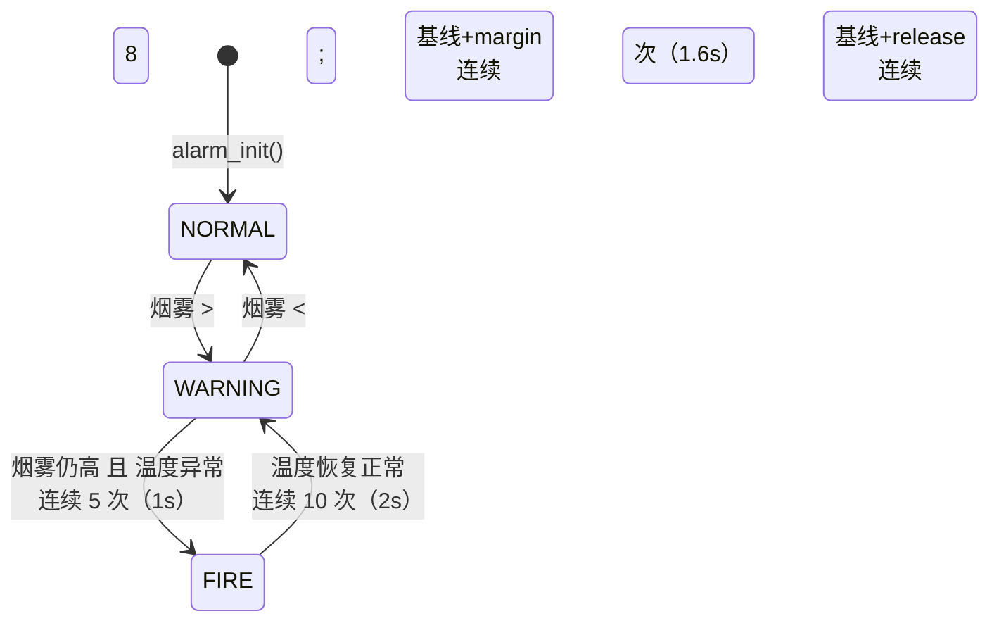

# stm32-smart-fire-system

[](https://github.com/mfw-breeze/stm32-smart-fire-system/actions/workflows/ci.yml)
[](LICENSE)

> 基于 STM32F103 的智能消防监测终端：MQ-2 烟雾 + DHT11 温湿度多传感器融合，
> 三态告警状态机（迟滞 + 连续确认 + 自适应基线），联动继电器喷水。

**这个仓库只放我自己的项目代码**，跟着教程练的外设例程在另一个仓库
（[embedded-learning-log](https://github.com/mfw-breeze/embedded-learning-log)）。

## 为什么值得看

| 特点 | 说明 |
|---|---|
| **可测试** | 告警决策逻辑与硬件解耦，8 组场景 / 71 项断言，`make test` 即可跑，**每次 push 由 CI 自动验证** |
| **一份代码两处用** | `app/alarm.c` 既编译进固件，也是 PC 测试的被测对象 —— 不存在「测试测的是另一份实现」 |
| **抗误报** | 自适应基线 + 迟滞 + 连续 8 次确认，抑制漂移、抖动和毛刺 |
| **防误喷** | 只有「烟 + 温升」同时成立才喷水，单有烟雾只预警 |
| **可标定** | 阈值集中在 `app/alarm_config.h`，标定方法与实测数据见 `docs/calibration.md` |
| **能自恢复** | 独立看门狗 2s 兜底：主循环卡死自动复位，启动时上报复位原因（`POR` / `IWDG` / `SOFTWARE`）；调试器停住内核时自动冻结计数，不干扰打断点 |

## 状态机



| 状态 | 执行器 |
|---|---|
| `NORMAL` | LED2 亮，静音，继电器断开 |
| `WARNING` | LED2 亮，蜂鸣器慢响，**不喷水** |
| `FIRE` | LED1 亮，蜂鸣器急响，**继电器吸合喷水** |

设计取舍（为什么用自适应基线、为什么迟滞 16%、已知局限）见 [docs/state-machine.md](docs/state-machine.md)。
工程约定、当前进度与待办见 [docs/status.md](docs/status.md)。

## 目录结构

```
stm32-smart-fire-system/
├── app/
│   ├── main.c                 # 主循环：采样调度 / 执行器输出 / 显示 / CSV
│   ├── alarm.c / alarm.h      # 三态告警状态机（仅依赖 <stdint.h>，可移植）
│   ├── alarm_config.h         # 全部阈值，改这里就能重新标定
│   ├── stm32f10x_it.c / .h    # 中断服务函数
│   └── stm32f10x_conf.h       # 标准库裁剪配置
├── bsp/                       # 板级支持：Delay / MyADC / USART1
├── driver/                    # 器件驱动：MQ-2、DHT11、OLED、继电器、蜂鸣器、LED、按键
├── vendor/                    # ST 标准外设库 + 启动文件（非本人代码，遵循 ST 原许可）
├── tests/                     # PC 端单元测试（不需要开发板）
├── docs/                      # 状态机 / 硬件接线 / 标定记录
├── project.uvprojx            # Keil MDK 工程（目标 STM32F103C8）
└── LICENSE (MIT)
```

## 构建

### 固件（Keil MDK）

1. Keil MDK 5.x 打开 `project.uvprojx`
2. `F7` 编译 → `F8` 下载
3. 目标芯片 STM32F103C8，STM32F10x 标准外设库

> `vendor/` 下是 ST 的标准库与 CMSIS，未做改动；`IncludePath` 已配好
> （`.\vendor\Start;.\vendor\Library;.\app;.\bsp;.\driver`）。

### 单元测试（PC，不需要开发板）

```bash
cd tests
make test
```

或者手动：

```bash
gcc -std=c99 -Wall -Wextra -I../app test_alarm.c ../app/alarm.c -o test_alarm && ./test_alarm
```

期望输出：`通过 71 项，失败 0 项` / `OK`。

覆盖的场景：

| 编号 | 场景 | 验证点 |
|---|---|---|
| S1 | 洁净空气静置 | 不误报；基线不漂 |
| S2 | 烟雾持续偏高 | 第 8 次才触发预警（前 7 次不动作） |
| S3 | 断续毛刺 | 单点尖峰不触发，计数清零 |
| S4 | 只有烟雾、温度正常 | 停在 `WARNING`，不升级火警 |
| S5 | 烟 + 温升 | 连续 5 次后升级 `FIRE` |
| S6 | 火警后温度恢复 | 连续 10 次后降级回 `WARNING` |
| S7 | 烟雾回落 | 连续 8 次后解除回 `NORMAL` |
| S8 | 温度判据 | 绝对超温 45°C / 窗口内升温 3°C 都判异常 |

## 关键参数

| 参数 | 值 | 含义 |
|---|---|---|
| `ALARM_RISE_PCT` | 32% | 触发点 = 基线 × 1.32（基线 1262 时约 1666） |
| `ALARM_FALL_PCT` | 16% | 解除点 = 基线 × 1.16，形成迟滞 |
| `ALARM_MIN_MARGIN` | 400 | 基线过低时的绝对下限 |
| `ALARM_CONFIRM_CNT` | 8 | 状态切换确认次数（8 × 200ms = 1.6s） |
| `ALARM_BASE_WEIGHT` | 64 | 基线低通时间常数（约 12.8s） |
| `ALARM_TEMP_ABS` | 45°C | 绝对超温 |
| `ALARM_TEMP_RISE` | 3°C | 10s 窗口内升温阈值 |

## 硬件

STM32F103C8T6 + MQ-2 + DHT11 + 5V 继电器 + 0.96" OLED + 有源蜂鸣器。
完整引脚表、供电注意事项、实测干扰现象见 [docs/hardware.md](docs/hardware.md)。

## 路线图

- [x] **v0.1** 告警决策核心 + PC 单元测试 + 设计文档
- [x] **v0.2** 固件层按 `bsp/ · driver/ · app/` 分层迁移；主程序改用可测试的告警核心；CI 自动跑测试
- [x] **v0.3a** IWDG 独立看门狗（2s 超时 + 复位原因上报，调试时冻结计数）
- [ ] **v0.3b** 阈值掉电保存（内部 Flash 最后一页）
- [ ] **v0.3c** 串口协议升级为 `帧头 + 长度 + CRC16`，配套上位机
- [ ] **v0.3d** 传感器自检（读数贴 0 或满量程时报警）
- [ ] **v0.4** 多节点：CAN / RS485 组网，接入工业测控终端

## 许可证

本项目代码遵循 [MIT](LICENSE)。
`vendor/` 目录下的 STM32F10x 标准外设库与 CMSIS 文件遵循 STMicroelectronics 的原始许可，
不属于本 MIT 许可范围。
