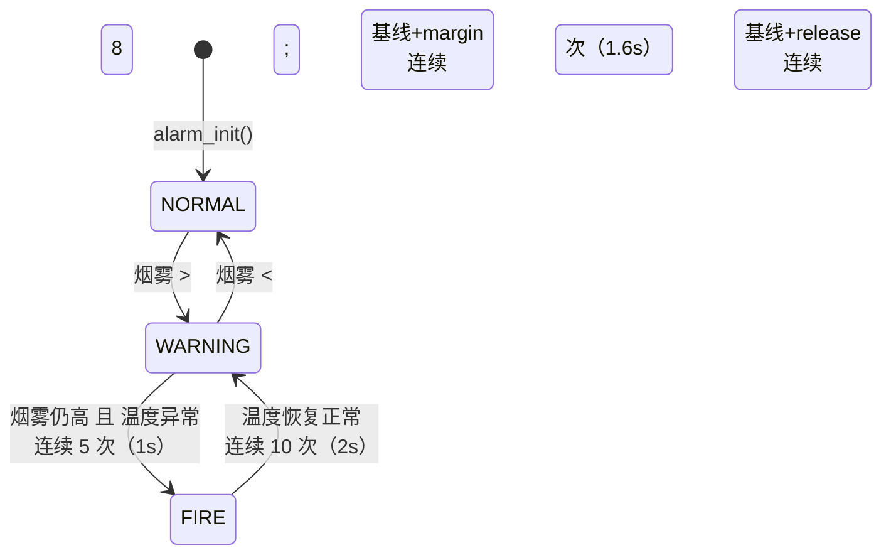

# stm32-smart-fire-system

> 基于 STM32F103 的智能消防监测终端：MQ-2 烟雾 + DHT11 温湿度多传感器融合，
> 三态告警状态机（迟滞 + 连续确认 + 自适应基线），联动继电器喷水。

**这个仓库只放我自己的项目代码**，跟着教程练的外设例程在另一个仓库
（[embedded-learning-log](https://github.com/mfw-breeze/embedded-learning-log)）。

## 为什么值得看

| 特点 | 说明 |
|---|---|
| **可测试** | 告警决策逻辑与硬件解耦，`tests/` 里有 8 组场景，PC 上直接跑，不需要开发板 |
| **抗误报** | 自适应基线 + 迟滞 + 连续 8 次确认，抑制漂移、抖动和毛刺 |
| **防误喷** | 只有"烟 + 温升"同时成立才喷水，单有烟雾只预警 |
| **可标定** | 所有阈值集中在 `app/alarm_config.h`，标定方法记在 `docs/calibration.md` |

## 状态机



| 状态 | 执行器 |
|---|---|
| `NORMAL` | LED2 亮，静音，继电器断开 |
| `WARNING` | LED2 亮，蜂鸣器慢响，**不喷水** |
| `FIRE` | LED1 亮，蜂鸣器急响，**继电器吸合喷水** |

详细设计（为什么用自适应基线、为什么迟滞 16%）见 [docs/state-machine.md](docs/state-machine.md)。

## 目录结构

```
stm32-smart-fire-system/
├── app/
│   ├── alarm.c / alarm.h         # 三态告警状态机（可移植，仅依赖 <stdint.h>）
│   └── alarm_config.h            # 全部阈值，改这里就能重新标定
├── tests/
│   ├── test_alarm.c              # 8 组场景，覆盖 4 条状态转移
│   └── Makefile
├── docs/
│   ├── state-machine.md          # 状态图、转移表、设计取舍、已知局限
│   ├── hardware.md               # 器件清单、引脚表、供电与实测现象
│   └── calibration.md            # MQ-2 预热、基线测量、阈值推导、重新标定步骤
└── LICENSE (MIT)
```

## 跑测试

不需要开发板，只需要一个 C 编译器：

```bash
cd tests
make test          # 或者：gcc -std=c99 -Wall -Wextra -I../app test_alarm.c ../app/alarm.c -o test_alarm && ./test_alarm
```

期望输出：

```
=== alarm 状态机单元测试 ===
[S1] 洁净空气静置
[S2] 烟雾持续偏高 → 预警
...
--------------------------------
通过 71 项，失败 0 项
OK
```

编译验证：MSVC 2022 (cl /std:c11 /utf-8) 与 gcc -std=c99 均可编译，当前 71 项断言全部通过。

覆盖的场景：

| 编号 | 场景 | 验证点 |
|---|---|---|
| S1 | 洁净空气静置 | 不误报；基线不漂 |
| S2 | 烟雾持续偏高 | 第 8 次才触发预警（前 7 次不动作） |
| S3 | 断续毛刺 | 单点尖峰不触发，计数清零 |
| S4 | 只有烟雾、温度正常 | 停在 `WARNING`，不升级火警 |
| S5 | 烟 + 温升 | 连续 5 次后升级 `FIRE` |
| S6 | 火警后温度恢复 | 连续 10 次后降级回 `WARNING` |
| S7 | 烟雾回落 | 连续 8 次后解除回 `NORMAL` |
| S8 | 温度判据 | 绝对超温 45°C / 窗口内升温 3°C 都判异常 |

## 关键参数

| 参数 | 值 | 含义 |
|---|---|---|
| `ALARM_RISE_PCT` | 32% | 触发点 = 基线 × 1.32（基线 1262 时约 1666） |
| `ALARM_FALL_PCT` | 16% | 解除点 = 基线 × 1.16，形成迟滞 |
| `ALARM_MIN_MARGIN` | 400 | 基线过低时的绝对下限 |
| `ALARM_CONFIRM_CNT` | 8 | 状态切换确认次数（8 × 200ms = 1.6s） |
| `ALARM_BASE_WEIGHT` | 64 | 基线低通时间常数（约 12.8s） |
| `ALARM_TEMP_ABS` | 45°C | 绝对超温 |
| `ALARM_TEMP_RISE` | 3°C | 10s 窗口内升温阈值 |

## 硬件

STM32F103C8T6 + MQ-2 + DHT11 + 5V 继电器 + 0.96" OLED + 有源蜂鸣器。
完整引脚表、供电注意事项、实测现象见 [docs/hardware.md](docs/hardware.md)。

## 路线图

- [x] **v0.1** 告警决策核心 + PC 单元测试 + 设计文档（当前）
- [ ] **v0.2** 固件层按 `bsp/ · driver/ · app/` 分层迁移；把 OLED / 延时 / 串口驱动重写并纳入本仓
- [ ] **v0.2** IWDG 看门狗 + 阈值掉电保存（内部 Flash）
- [ ] **v0.3** 串口协议升级为 `帧头 + 长度 + CRC16`，配套上位机
- [ ] **v0.3** 传感器自检（读数贴 0 或满量程时报警）
- [ ] **v0.4** 多节点：CAN / RS485 组网，接入工业测控终端

## 说明

v0.1 只包含与硬件无关的决策核心。原型固件（含 OLED/DHT11/MQ-2 驱动）是从学习工程里
长出来的，正在按 `bsp/driver/app` 重新分层，迁移完成后再进本仓 —— 现在把那份代码直接搬进来，
只会让仓库一半是教程结构、一半是新架构，两边都不干净。

## 许可证

[MIT](LICENSE)
