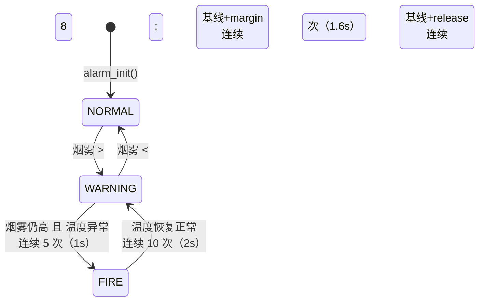

# 告警状态机

## 状态转移图



## 三态定义

| 状态 | 含义 | 执行器动作 |
|---|---|---|
| `NORMAL` | 无异常 | LED2 亮，蜂鸣器静音，继电器断开 |
| `WARNING` | 有烟但温度正常，可能是香烟/蒸汽/误报 | LED2 亮，蜂鸣器慢响，**不喷水** |
| `FIRE` | 烟 + 高温同时成立 | LED1 亮，蜂鸣器急响，**继电器吸合喷水** |

`WARNING` 的存在就是为了防误喷：只凭 MQ-2 一路传感器，抽烟、蒸汽、香水都可能触发，
把"喷水"这个不可逆动作绑定到"烟 + 温升"两个独立证据上。

## 转移条件表

| 从 | 到 | 条件 | 确认次数 | 事件 |
|---|---|---|---|---|
| NORMAL | WARNING | `smoke > baseline + margin` | 8（1.6s） | `ALARM_EVT_WARN` |
| WARNING | NORMAL | `smoke < baseline + release` | 8（1.6s） | `ALARM_EVT_CLEAR` |
| WARNING | FIRE | `smoke > baseline + margin && temp_bad` | 5（1s） | `ALARM_EVT_FIRE` |
| FIRE | WARNING | `!temp_bad` | 10（2s） | `ALARM_EVT_DOWN` |

## 关键设计

### 1. 自适应基线（而不是固定阈值）

MQ-2 的输出会随温度、湿度、老化缓慢漂移，固定阈值要么经常误报、要么漏报。

```
baseline = (baseline × 63 + smoke) / 64     ← 一阶低通，时间常数约 12.8s
margin   = max(baseline × 32%, 400)         ← 相对阈值 + 绝对下限
release  = max(baseline × 16%, 200)         ← 解除线，形成迟滞
```

**基线只在 `NORMAL` 态跟踪**。一旦进入 `WARNING`，基线冻结 —— 否则烟雾持续存在时
基线会被"学习"上去，阈值越抬越高，最后自己把自己劝退。

### 2. 迟滞（hysteresis）

触发线比解除线高 16%，避免烟雾值在阈值附近抖动时状态来回跳，导致蜂鸣器和继电器
反复动作（继电器每分钟吸合几十次会显著缩短寿命）。

### 3. 连续 N 次确认

所有判定都是"连续 N 次成立"，任何一次不成立立即清零。1.6s 的窗口足以滤掉
ADC 毛刺、电源波动、继电器触点弹跳引起的单点尖峰。

### 4. 温度用"绝对 + 变化率"双判据

- 绝对：`temp >= 45°C`
- 变化率：10 秒窗口内升温 `>= 3°C`

只看绝对值会漏掉早期火灾（环境本来就 30°C，起火后 38°C 还不算"高"但已经很危险）；
只看变化率会被空调、开门扰动干扰。两个条件取"或"，互补。

## 已知局限

1. **缓慢漂移会被基线吸收**。如果烟雾是缓慢上升（比如几十分钟才翻倍），
   自适应基线会一路跟上去，可能不触发。这是用"抗误报"换来的代价，
   靠温度判据兜底。
2. **单点传感器没有冗余**。MQ-2 失效（或加热丝断了）时，读数会掉到很低，
   系统只会认为"环境变干净了"。v0.3 打算加传感器自检（读数长期贴近 0 或满量程时报警）。
3. **没有掉电保存**。阈值改动后重启会回到编译期的值。v0.2 用内部 Flash 保存标定参数。

## 时间基准

| 调用 | 周期 | 谁调 |
|---|---|---|
| `alarm_update()` | 200 ms | 主循环 |
| `alarm_feed_temp()` | 2 s | 主循环（DHT11 不宜快读） |

上面所有"秒"都是按这两个周期换算的。改周期必须同步改 `alarm_config.h` 里的注释。
